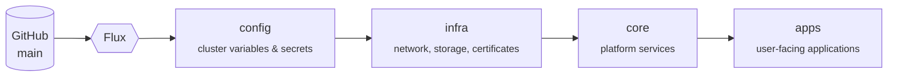
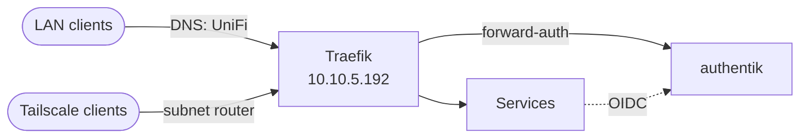
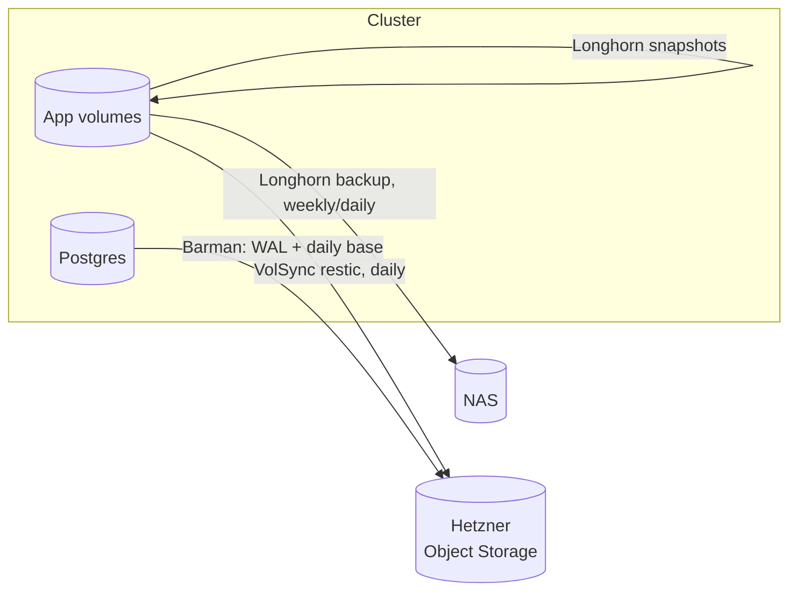

# ⭐ Polaris

> *Your North Star in the Infrastructure Galaxy*

[](https://www.talos.dev/)
[](https://kubernetes.io/)
[](https://fluxcd.io/)
[](https://cilium.io/)
[](https://docs.renovatebot.com/)

Polaris is my homelab: a small bare-metal Kubernetes cluster running the self-hosted services I use every day — media, documents, home automation, bookmarks — together with the platform needed to run them properly: storage, backups, single sign-on, observability.

Everything is declared in this repository. [Talos Linux](https://www.talos.dev/) provides an immutable, API-driven OS; [Flux](https://fluxcd.io/) continuously reconciles the cluster against `main`; [Renovate](https://docs.renovatebot.com/) keeps every chart and image up to date through pull requests. Nothing is installed by hand except the bootstrap.

## 🧭 At a glance

| | |
| --- | --- |
| **Nodes** | 3 control plane (HP ProDesk 400 G2) + 1 worker (Minisforum MS-01), all schedulable |
| **OS / Kubernetes** | Talos Linux, configured with [talhelper](https://budimanjojo.github.io/talhelper/) |
| **GitOps** | Flux, layered `config → infra → core → apps` |
| **Networking** | Cilium (eBPF, kube-proxy replacement, L2 LoadBalancer), Traefik ingress |
| **Storage** | Longhorn on node disks, NFS from the NAS for media |
| **Backups** | VolSync (restic) and CloudNativePG/Barman to Hetzner Object Storage, Longhorn backups to the NAS |
| **Identity** | authentik — OIDC or forward-auth in front of every UI |
| **Secrets** | SOPS + age in Git for bootstrap secrets, Bitwarden Secrets Manager + External Secrets at runtime |
| **Observability** | Prometheus, Grafana, Alertmanager, Loki + Alloy |
| **Remote access** | Tailscale subnet router |

## 🏗️ Architecture

Flux applies the repository in four layers. Each layer waits for the previous one, so a cluster can be rebuilt from scratch with a single bootstrap and no manual ordering.



Inside a layer every component has its own Flux `Kustomization` with explicit `dependsOn`, so components start as soon as what they really need is ready. Two rules keep the layers independent:

- **Lower layers never depend on higher ones.** Prometheus monitors and Traefik ingresses for `infra` components live in [`core/prometheus/monitors`](k8s/core/prometheus/README.md) and [`core/traefik/ingresses`](k8s/core/traefik/README.md), not next to the components.
- **Reusable pieces are Kustomize components** ([`k8s/components`](k8s/components/README.md)): an app opts into backups by including a component and setting a few variables.

### Traffic



Services get a `*.polarislab.dev` hostname: ExternalDNS writes the record into the UniFi gateway and cert-manager issues a Let's Encrypt certificate. Nothing is exposed to the Internet; remote access goes through Tailscale.

### Backups



Every application volume has a local copy on the NAS and an off-site copy on Hetzner; databases are backed up continuously with point-in-time recovery. Volumes restore themselves: a PVC recreated by Flux is populated from the latest backup before the app starts. See [VolSync](k8s/components/README.md#volsync) and [CloudNativePG](k8s/core/cnpg/README.md).

## 📦 What runs here

<details open>
<summary><b>Applications</b> — <code>k8s/apps</code></summary>

| App | What it does |
| --- | --- |
| [arr-stack](k8s/apps/arr-stack/README.md) | Media automation: Sonarr, Radarr, Prowlarr, qBittorrent (behind a VPN), autobrr, Cleanuparr |
| [jellyfin](k8s/apps/jellyfin/README.md) | Media server with Intel Quick Sync transcoding |
| [seerr](k8s/apps/seerr/README.md) | Media requests for Jellyfin users |
| [paperless](k8s/apps/paperless/README.md) | Document archive with OCR and AI tagging |
| [karakeep](k8s/apps/karakeep/README.md) | Bookmarks and read-later with AI tagging |
| [home-assistant](k8s/apps/home-assistant/README.md) | Home automation |
| [bentopdf](k8s/apps/bentopdf/README.md) · [excalidraw](k8s/apps/excalidraw/README.md) · [metube](k8s/apps/metube/README.md) · [openspeedtest](k8s/apps/openspeedtest/README.md) | Small stateless tools |

Disabled, kept for reference: [forgejo](k8s/apps/forgejo/README.md), [mealie](k8s/apps/mealie/README.md), [n8n](k8s/apps/n8n/README.md), [planka](k8s/apps/planka/README.md).

</details>

<details>
<summary><b>Platform</b> — <code>k8s/core</code></summary>

| Component | What it does |
| --- | --- |
| [traefik](k8s/core/traefik/README.md) | Ingress controller |
| [authentik](k8s/core/authentik/README.md) | Identity provider and SSO |
| [cnpg](k8s/core/cnpg/README.md) | CloudNativePG operator and Barman backups for Postgres |
| [external-secrets](k8s/core/external-secrets/README.md) | Secrets from Bitwarden Secrets Manager |
| [external-dns](k8s/core/external-dns/README.md) | DNS records on the UniFi gateway |
| [prometheus](k8s/core/prometheus/README.md) | Metrics, dashboards and alerts |
| [loki](k8s/core/loki/README.md) | Logs |
| [tailscale](k8s/core/tailscale/README.md) | Remote access |

</details>

<details>
<summary><b>Infrastructure</b> — <code>k8s/infra</code></summary>

| Component | What it does |
| --- | --- |
| [cilium](k8s/infra/cilium/README.md) | CNI, kube-proxy replacement, LoadBalancer IPs |
| [cert-manager](k8s/infra/cert-manager/README.md) | TLS certificates |
| [longhorn](k8s/infra/longhorn/README.md) | Replicated block storage, snapshots, NAS backups |
| [snapshot-controller](k8s/infra/snapshot-controller/README.md) | CSI volume snapshots |
| [volsync](k8s/infra/volsync/README.md) | Volume backup and restore operator |
| [metrics-server](k8s/infra/metrics-server/README.md) | Resource metrics API |
| [intel-gpu-plugin](k8s/infra/intel-gpu-plugin/README.md) | Exposes the Intel iGPU to pods |

</details>

## 🗂️ Repository layout

```text
.
├── talos/                 # Talos node configuration (talhelper) and bootstrap guide
└── k8s/
    ├── flux/              # Flux installation and the four layer Kustomizations
    ├── config/            # Cluster-wide variables and SOPS-encrypted secrets
    ├── components/        # Reusable Kustomize components (VolSync, CNPG backups)
    ├── infra/             # Layer 1: network, storage, certificates
    ├── core/              # Layer 2: platform services
    └── apps/              # Layer 3: applications
```

Every component folder follows the same shape: a `ks.yaml` with its Flux Kustomizations, a `namespace.yaml`, and one subfolder per Kustomization (`app/`, `database/`, …). Each has a README describing what it does and how to maintain it.

## 🚀 Getting started

Rebuilding the cluster from zero is described in [talos/README.md](talos/README.md): generate the Talos configs, bootstrap the nodes, install Cilium once, bootstrap Flux. Flux takes it from there.

## 🙏 Acknowledgments

- [onedr0p/home-ops](https://github.com/onedr0p/home-ops) and the [Home Operations](https://discord.gg/home-operations) community for many of the patterns used here
- [Talos Linux](https://www.talos.dev/), [talhelper](https://budimanjojo.github.io/talhelper/), [Flux](https://fluxcd.io/), [Cilium](https://cilium.io/)

## 📝 License

MIT.
