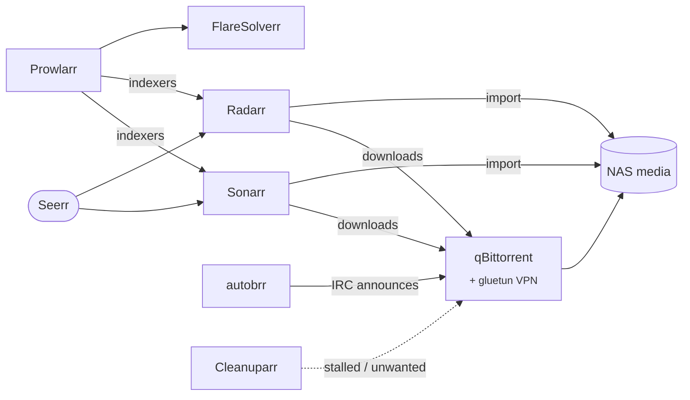

# arr-stack

Media automation: finds, downloads, renames and cleans up movies and series, which [Jellyfin](../jellyfin/README.md) then serves. Requests come from [Seerr](../seerr/README.md).

| | |
| --- | --- |
| **Namespace** | `arr-stack` |
| **Media** | NFS from the NAS (`${NAS_DOMAIN}:/volume1/media`) |
| **Config volumes** | one per app, backed up with the [`volsync` component](../../components/README.md#volsync) |
| **Network** | default-deny ingress; Traefik, Prometheus and Seerr (to Sonarr/Radarr) are allowed in |

## Apps

| App | URL | Auth | Config volume (UID) | Backup at |
| --- | --- | --- | --- | --- |
| Sonarr | `sonarr.${CLUSTER_DOMAIN}` | forward-auth | `sonarr-config` (911) | 04:25 |
| Radarr | `radarr.${CLUSTER_DOMAIN}` | forward-auth | `radarr-config` (911) | 04:20 |
| Prowlarr | `prowlarr.${CLUSTER_DOMAIN}` | forward-auth | `prowlarr-config` (911) | 04:10 |
| qBittorrent | `qbittorrent.${CLUSTER_DOMAIN}` | forward-auth | `qbittorrent-config` (1000) | 04:15 |
| Cleanuparr | `cleanuparr.${CLUSTER_DOMAIN}` | forward-auth | `cleanuparr-config` (1000) | 04:05 |
| autobrr | `autobrr.${CLUSTER_DOMAIN}` | OIDC | `autobrr-config` (root) | 04:00 |
| FlareSolverr | internal only | — | — | — |

Forward-auth uses the `authentik` Middleware in `media/`, pointing to the `ak-outpost-traefik` outpost. The UID column is the user the VolSync mover runs as: it must match the owner of the files (linuxserver.io images write as `911`).

## Structure

Each app has its own Flux Kustomization (`apps-arr-stack-<app>`), so one failing app does not block the others.

| Folder | Content |
| --- | --- |
| `media/` | NFS PersistentVolumes/Claims (`media-root`, `media-media`, `media-torrents`), the forward-auth Middleware, the namespace NetworkPolicy. Apps mounting media depend on it |
| `<app>/` | Deployment, Service, Ingress, ExternalSecrets, `kustomization.yaml` with the VolSync component |

| Volume | NAS path | Mounted by |
| --- | --- | --- |
| `media-root` | `/volume1/media/` | Sonarr, Radarr (downloads and library on the same share, so imports are hardlinks) |
| `media-torrents` | `/volume1/media/torrents` | qBittorrent, Cleanuparr |
| `media-media` | `/volume1/media/media` | — (library only) |

## qBittorrent and the VPN

qBittorrent runs with a [gluetun](https://github.com/qdm12/gluetun) sidecar (native sidecar init container): all its traffic leaves through Private Internet Access (Netherlands). The gluetun firewall allows the pod, LAN and cluster ranges so the WebUI and the *arr apps keep working. PIA credentials come from Bitwarden.

The WebUI has authentication disabled for every subnet (`AuthSubnetWhitelist=0.0.0.0/0`): access control relies entirely on authentik forward-auth at the Ingress.

## Maintenance

- **Cleanuparr not ready after a restart**: it caches the health of qBittorrent/Sonarr/Radarr from its startup. If it starts before them it stays *Unhealthy*; `kubectl -n arr-stack rollout restart deploy/cleanuparr`.
- **Restore an app**: see the [VolSync runbooks](../../components/README.md#runbooks).
