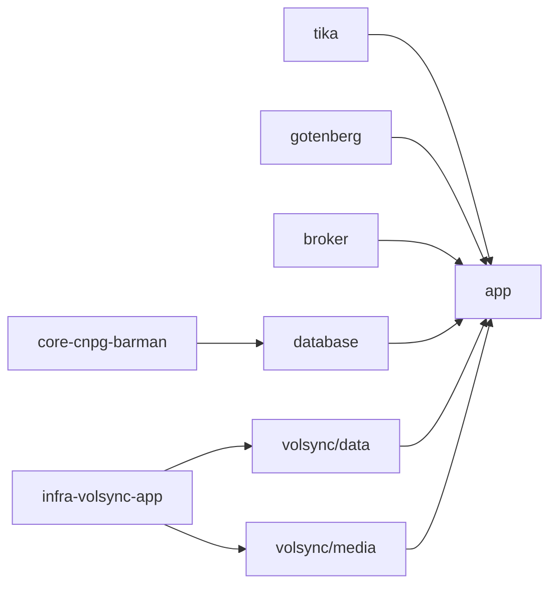

# Paperless-ngx

Document archive: scans and PDFs are OCR'd (Italian), classified and made searchable, with AI-assisted tagging.

| | |
| --- | --- |
| **Namespace** | `paperless` |
| **URL** | `https://paperless.${CLUSTER_DOMAIN}` |
| **Auth** | OIDC with authentik only (regular login disabled; `admins` group → superuser) |
| **Secrets** | `paperless-secret`, `sso-client`, `openai-cred` from Bitwarden |

## Structure

| Folder | Flux Kustomization | Content |
| --- | --- | --- |
| `app/` | `apps-paperless-app` | Paperless webserver, config, Ingress, `consume`/`export` volumes |
| `database/` | `apps-paperless-database` | CNPG `paperless-pg` + [`cnpg-backup`](../../components/README.md#cnpg-backup) |
| `broker/` | `apps-paperless-broker` | Valkey (task queue) |
| `tika/` · `gotenberg/` | `apps-paperless-tika` · `-gotenberg` | Office document parsing and conversion |
| `volsync/data` · `volsync/media` | `apps-paperless-volsync-data` · `-media` | The two important volumes, each with the [`volsync` component](../../components/README.md#volsync) |

The VolSync component handles one PVC per Flux Kustomization, hence the two small folders under `volsync/`.

## Data and backups

| Data | Volume | Protection |
| --- | --- | --- |
| Documents and thumbnails | `paperless-media` (50 Gi, `longhorn-critical`) | VolSync daily 04:40 + Longhorn critical (2-hourly snapshots, daily NAS backup) |
| Index, classifier | `paperless-data` (5 Gi, `longhorn-critical`) | VolSync daily 04:35 + Longhorn critical |
| Metadata (tags, correspondents, …) | `paperless-pg` | Barman: continuous WAL, daily base, 30 days PITR |
| Inbox / exports | `paperless-consume`, `paperless-export` | none (transient) |
| Queue | `broker-data` | none |

> [!IMPORTANT]
> Documents are only useful together with the database. After a disaster, restore **both**: the volumes come back automatically, the database needs the [CloudNativePG recovery](../../core/cnpg/README.md#recovery) procedure. Restore to a database point in time close to the last VolSync backup.

## Maintenance

- The database single instance has `enablePDB: false` so node drains are not blocked.
- Built-in exporter, for a portable copy: `kubectl -n paperless exec deploy/paperless -- document_exporter ../export`.
