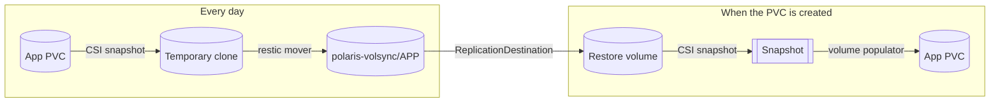

# Components

Reusable [Kustomize components](https://kubectl.docs.kubernetes.io/guides/config_management/components/). An app opts in by listing the component in its `kustomization.yaml` and setting a few variables through Flux `postBuild.substitute` in its `ks.yaml`.

| Component | Purpose |
| --- | --- |
| [`volsync`](#volsync) | Daily backup of one PVC to Hetzner Object Storage, automatic restore on PVC creation |
| [`cnpg-backup`](#cnpg-backup) | Continuous backup of a CloudNativePG cluster (WAL + daily base backup) |

Both write to Hetzner Object Storage (`nbg1`) with the same credentials, stored in Bitwarden Secrets Manager:

| Bucket | Used by |
| --- | --- |
| `polaris-volsync` | one restic repository per app: `s3://polaris-volsync/<APP>` |
| `polaris-cnpg` | one Barman folder per cluster: `s3://polaris-cnpg/<cluster>` |

---

## volsync

Backs up a single PVC with [VolSync](https://volsync.readthedocs.io/) and restic, and creates that PVC with a `dataSourceRef` pointing to a `ReplicationDestination`. Whenever the PVC is created — new cluster, deleted namespace, accidental `kubectl delete` — it is populated from the latest backup before the app can mount it. If the repository is still empty, the PVC simply starts empty.



### What it creates

| Object | Name | Notes |
| --- | --- | --- |
| `ExternalSecret` | `<APP>-volsync` | restic repository URL, password and S3 credentials |
| `ReplicationSource` | `<APP>` | daily backup; keeps 7 daily, 4 weekly, 3 monthly snapshots; prunes weekly |
| `ReplicationDestination` | `<APP>-dst` | `restore-once` trigger, used as the PVC data source |
| `PersistentVolumeClaim` | `<VOLSYNC_CLAIM>` | the app volume itself |

### Variables

| Variable | Required | Default | Description |
| --- | --- | --- | --- |
| `APP` | yes | | Object names and restic repository path |
| `VOLSYNC_CLAIM` | yes | | Name of the PVC to create and back up |
| `VOLSYNC_CAPACITY` | yes | | PVC size |
| `VOLSYNC_STORAGECLASS` | no | `longhorn-default` | Storage class of the app PVC |
| `VOLSYNC_SCHEDULE` | no | `0 4 * * *` | Backup schedule; stagger apps by a few minutes |
| `VOLSYNC_UID` / `VOLSYNC_GID` | no | `1000` | User the mover runs as: it must be able to read every file (`0` for apps writing as root, `911` for linuxserver.io images) |

### Storage classes

- The point-in-time clone read during a backup and the restore volume use `longhorn-volsync` (one replica, `Delete` reclaim, no Longhorn jobs). The clone is deleted after each run; the restore volume is kept because the snapshot that populates the PVC lives inside it.
- The restic cache uses `longhorn-ephemeral`.

### Adding an app

1. In the app folder, add the component and set the namespace:

   ```yaml
   # k8s/apps/<app>/app/kustomization.yaml
   apiVersion: kustomize.config.k8s.io/v1beta1
   kind: Kustomization
   namespace: <namespace>
   resources:
     - ./deployment.yaml
   components:
     - ../../../components/volsync
   ```

   If the folder also contains objects of other namespaces (e.g. a `HelmRepository` in `flux-system`), put the component in a subfolder with its own `kustomization.yaml` instead, as in [`core/prometheus/app/volsync`](../core/prometheus/app/volsync).

2. Remove the PVC from the app manifests (or point the Helm chart to it with `existingClaim`) and set the variables in `ks.yaml`, plus a dependency on VolSync:

   ```yaml
   spec:
     dependsOn:
       - name: infra-volsync-app
     postBuild:
       substitute:
         APP: <app>
         VOLSYNC_CLAIM: <app>-config
         VOLSYNC_CAPACITY: 5Gi
   ```

3. For an **existing** app, the PVC cannot simply be replaced: `dataSourceRef` is immutable. Take a first backup before switching:

   1. `flux suspend ks <ks>` and scale the app to 0;
   2. apply only the `ExternalSecret` and `ReplicationSource` (from `flux build ks ... --dry-run`) and wait for `status.lastSyncTime`;
   3. delete the old PVC (if it has the same name) and `flux resume ks <ks>`: the new PVC is restored from the backup.

   If the new PVC has a different name, use a temporary `ReplicationSource` reading from the old PVC into the same repository instead.

### Runbooks

<details>
<summary><b>Check the backups</b></summary>

```sh
kubectl get replicationsource -A \
  -o custom-columns=NS:.metadata.namespace,APP:.metadata.name,LAST:.status.lastSyncTime,RESULT:.status.latestMoverStatus.result
kubectl -n <ns> get replicationsource <app> -o jsonpath='{.status.latestMoverStatus.logs}'
```

</details>

<details>
<summary><b>Restore an app to the latest backup</b></summary>

The `ReplicationDestination` only runs once (`restore-once`), so its snapshot is the one taken when the app was first restored. Before recreating a PVC on a running cluster, trigger a fresh restore:

```sh
kubectl -n <ns> patch replicationdestination <app>-dst --type merge \
  -p '{"spec":{"trigger":{"manual":"restore-'$(date +%s)'"}}}'
# wait until .status.lastManualSync matches, then:
flux suspend ks <ks>
kubectl -n <ns> scale deploy <app> --replicas=0
kubectl -n <ns> delete pvc <claim>
flux resume ks <ks>
```

On a freshly rebuilt cluster nothing is needed: every `ReplicationDestination` is new and restores the latest snapshot.

</details>

<details>
<summary><b>Restore an older snapshot</b></summary>

Set `spec.restic.restoreAsOf` (RFC 3339 timestamp) or `spec.restic.previous` (number of snapshots to skip) on the `ReplicationDestination`, trigger it as above, then recreate the PVC. Remove the field afterwards.

</details>

<details>
<summary><b>Repository locked or corrupted</b></summary>

A mover killed mid-run can leave a stale restic lock. Set `spec.restic.unlock` on the `ReplicationSource` to any new value; the next run unlocks the repository first.

</details>

---

## cnpg-backup

Backs up a [CloudNativePG](https://cloudnative-pg.io/) cluster with the [Barman Cloud plugin](https://cloudnative-pg.io/plugin-barman-cloud/): WAL files are archived as they are written and a base backup is taken every day at 03:00 UTC, with 30 days of retention. Any point in that window can be restored.

| Object | Name | Notes |
| --- | --- | --- |
| `ExternalSecret` | `<CNPG_CLUSTER>-s3` | S3 credentials and region |
| `ObjectStore` | `<CNPG_CLUSTER>-s3` | `s3://polaris-cnpg/`, gzip, 30d retention |
| `ScheduledBackup` | `<CNPG_CLUSTER>-daily` | daily base backup, also taken once at creation |
| patch on `Cluster` | | enables the plugin as WAL archiver |

| Variable | Required | Description |
| --- | --- | --- |
| `CNPG_CLUSTER` | yes | Name of the `Cluster` in the same folder |

The cluster folder needs a `kustomization.yaml` including the component, and its Flux Kustomization must depend on `core-cnpg-barman`. The `ObjectStore` sets `AWS_REQUEST_CHECKSUM_CALCULATION` / `AWS_RESPONSE_CHECKSUM_VALIDATION` to `when_required`: recent AWS SDKs send checksums that Hetzner rejects.

> [!IMPORTANT]
> Restoring a database is **not** automatic. See the recovery procedure in [core/cnpg](../core/cnpg/README.md#recovery).
