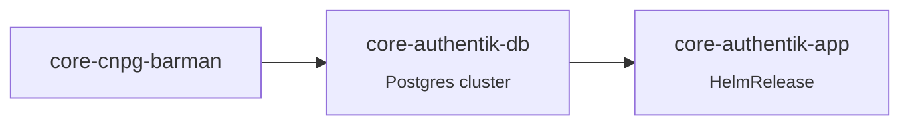

# authentik

Identity provider for the whole lab. Users log in once at `sso.${CLUSTER_DOMAIN}`; apps trust it either natively (OIDC) or through Traefik forward-auth for apps without a login of their own.

| | |
| --- | --- |
| **Namespace** | `authentik` |
| **Chart** | `authentik` (server + worker) |
| **URL** | `https://sso.${CLUSTER_DOMAIN}` |
| **Database** | CloudNativePG `authentik-pg`, backed up with [`cnpg-backup`](../../components/README.md#cnpg-backup) |
| **Secrets** | `secret-key-cred`, `smtp-cred` from Bitwarden |
| **Email** | Brevo SMTP relay |
| **Metrics** | server, worker and outposts, see [prometheus/monitors](../prometheus/README.md) |

## Structure

| Folder | Flux Kustomization | Content |
| --- | --- | --- |
| `database/` | `core-authentik-db` | CNPG `Cluster` + `cnpg-backup` component |
| `app/` | `core-authentik-app` | HelmRelease, ExternalSecrets |

## How apps authenticate

| Method | Apps |
| --- | --- |
| **OIDC** | Grafana, Paperless, Karakeep, Home Assistant ([hass-oidc-auth](https://github.com/christiaangoossens/hass-oidc-auth)), autobrr |
| **Forward-auth** (Traefik middleware → outpost `ak-outpost-traefik`) | Sonarr, Radarr, Prowlarr, qBittorrent, Cleanuparr, Longhorn |
| **LDAP** (outpost `ak-outpost-ldap`) | available for apps speaking LDAP only |
| **Own login** | Jellyfin, Seerr |

Providers, applications and outposts are configured in the authentik UI (stored in the database, not in Git). The two outposts are deployed and managed by authentik itself through its Kubernetes integration; they also create their own ServiceMonitors.

### Adding a forward-auth app

1. **Applications → Providers → Proxy Provider**, mode *Forward auth (single application)*, external host `https://<app>.${CLUSTER_DOMAIN}`.
2. **Applications → Create**, bound to the provider (and to a group/policy if access should be restricted).
3. **Outposts → ak-outpost-traefik**: add the application.
4. Add the Traefik `Middleware` and annotation to the app Ingress (see [traefik](../traefik/README.md)).

## Maintenance

- Startup takes several minutes after a database restart (migrations and module loading); the startup probe allows 10 minutes.
- Database recovery: [CloudNativePG recovery](../cnpg/README.md#recovery). authentik is the login for every other app, so restore it first.
