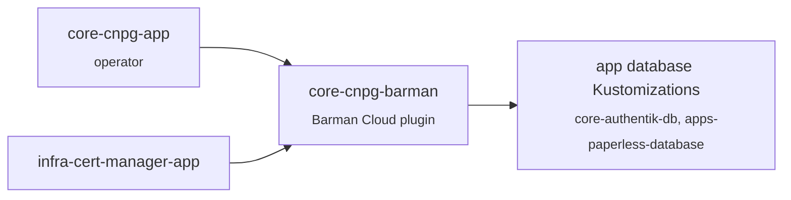

# CloudNativePG

PostgreSQL operator for the cluster. Every app needing Postgres gets its own `Cluster`, defined next to the app, and backed up to Hetzner Object Storage through the [`cnpg-backup`](../../components/README.md#cnpg-backup) component.

| | |
| --- | --- |
| **Namespace** | `cnpg-system` (operator); clusters live in the app namespaces |
| **Charts** | `cloudnative-pg`, `plugin-barman-cloud` |
| **Clusters** | [`authentik/authentik-pg`](../authentik/README.md), [`paperless/paperless-pg`](../../apps/paperless/README.md) |
| **Metrics** | operator and every instance, see [prometheus/monitors](../prometheus/README.md) |

## Structure



| Folder | Flux Kustomization | Content |
| --- | --- | --- |
| `app/` | `core-cnpg-app` | CloudNativePG operator |
| `barman/` | `core-cnpg-barman` | Barman Cloud plugin (needs cert-manager for its mTLS certificates) |

## Conventions for clusters

- **Single instance**, storage class `longhorn-database` (3 replicas, no Longhorn snapshots or backups: Barman covers them).
- **`enablePDB: false`**: with one instance the PodDisruptionBudget allows zero disruptions, which blocks node drains and Talos upgrades without making the database any more available.
- The database Flux Kustomization depends on `core-cnpg-barman` and includes the `cnpg-backup` component.

## Runbooks

### Check backups

```sh
kubectl get cluster -A   # STATUS should be "Cluster in healthy state"
kubectl -n <ns> get cluster <name> -o jsonpath='{range .status.conditions[*]}{.type}={.status}{"\n"}{end}'
# ContinuousArchiving=True and LastBackupSucceeded=True
kubectl -n <ns> get backups.postgresql.cnpg.io
kubectl -n <ns> get objectstore <name>-s3 -o jsonpath='{.status}'   # recovery window
```

> [!NOTE]
> Use `backups.postgresql.cnpg.io`: the short name `backup` also matches Longhorn's `backups.longhorn.io`.

When the plugin is first enabled on an existing cluster, the immediate backup fails with *"requested plugin is not available"* (the pod restarts with the sidecar afterwards). Run a manual one:

```sh
kubectl apply -f - <<EOF
apiVersion: postgresql.cnpg.io/v1
kind: Backup
metadata:
  name: <name>-manual-$(date +%s)
  namespace: <ns>
spec:
  cluster:
    name: <name>
  method: plugin
  pluginConfiguration:
    name: barman-cloud.cloudnative-pg.io
EOF
```

### Recovery

CloudNativePG only restores when a cluster is **created**, and a restored cluster must archive its new WAL files to a different folder than the one it reads from. The procedure is therefore: describe the recovery in Git, delete the cluster, let Flux recreate it.

1. **Stop the app** using the database (suspend its Flux Kustomization and scale it to 0), and suspend the database Kustomization:

   ```sh
   flux suspend ks <app-ks> && kubectl -n <ns> scale deploy <app> --replicas=0
   flux suspend ks <db-ks>
   ```

2. **Edit `pg-cluster.yaml`**: replace `bootstrap.initdb` with a recovery from the existing backups, and point WAL archiving to a new `serverName`:

   ```yaml
   spec:
     bootstrap:
       recovery:
         source: origin
         database: <db>
         owner: <owner>
         # recoveryTarget:
         #   targetTime: "2026-10-20 14:00:00+00"   # omit for the latest point
     externalClusters:
       - name: origin
         plugin:
           name: barman-cloud.cloudnative-pg.io
           parameters:
             barmanObjectName: <name>-s3
             serverName: <name>            # folder holding the backups
   ```

   and add to the `kustomization.yaml` a patch for the plugin added by the component:

   ```yaml
   patches:
     - target:
         kind: Cluster
       patch: |-
         - op: add
           path: /spec/plugins/0/parameters/serverName
           value: <name>-v2               # new WAL folder
   ```

3. **Recreate the cluster**: commit and push, then

   ```sh
   kubectl -n <ns> delete cluster <name>
   flux resume ks <db-ks>
   kubectl -n <ns> get cluster <name> -w      # wait for "Cluster in healthy state"
   flux resume ks <app-ks>
   ```

   The PVC of the old instance is kept (`Retain`); delete its PV and Longhorn volume once the app is verified.

4. **Afterwards**, keep `serverName: <name>-v2` for archiving. The next recovery reads from `<name>-v2` and writes to `<name>-v3`. The `bootstrap.recovery` section can stay: it is ignored once the cluster exists.

> [!TIP]
> To test a recovery without touching production, create a second cluster with a different name in the same namespace using the same `externalClusters` block, check the data, and delete it.

### Upgrade PostgreSQL

Minor versions: bump `imageName` (Renovate does it). Major versions: CloudNativePG supports in-place major upgrades by changing `imageName` to the new major; take a manual backup first.
