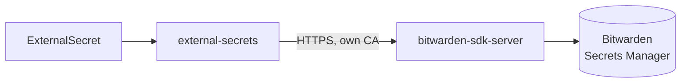

# External Secrets

Syncs runtime secrets from [Bitwarden Secrets Manager](https://bitwarden.com/products/secrets-manager/) into Kubernetes Secrets. Apps declare an `ExternalSecret` referencing Bitwarden secret IDs; no secret value is stored in Git.

| | |
| --- | --- |
| **Namespace** | `external-secrets` |
| **Chart** | `external-secrets` with the bundled `bitwarden-sdk-server` |
| **Store** | `ClusterSecretStore/bitwarden` |
| **Metrics** | controller, webhook, cert controller, see [prometheus/monitors](../prometheus/README.md) |

## Structure

| Folder | Flux Kustomization | Content |
| --- | --- | --- |
| `app/` | `core-external-secrets-app` | HelmRelease |
| `bitwarden/` | `core-external-secrets-bitwarden` | `ClusterSecretStore`, machine-account token (SOPS-encrypted), TLS for the SDK server |



The operator talks to the Bitwarden SDK server over TLS signed by a private CA built with cert-manager:

| Object | Namespace | Role |
| --- | --- | --- |
| `ClusterIssuer/bitwarden-bootstrap-issuer` | | self-signed issuer |
| `Certificate/bitwarden-bootstrap-certificate` | `cert-manager` | the CA: **10 years**, private key never rotated |
| `ClusterIssuer/bitwarden-certificate-issuer` | | issues from the CA |
| `Certificate/bitwarden-tls-certs` | `external-secrets` | SDK server certificate; its `ca.crt` is what the store trusts |

The CA is long-lived on purpose: with a CA renewed on the same schedule as the leaf, a leaf could be reissued with the previous CA in its `ca.crt`, and every ExternalSecret failed with `x509: certificate has expired` once that CA expired.

## Usage

```yaml
apiVersion: external-secrets.io/v1
kind: ExternalSecret
metadata:
  name: my-secret
spec:
  refreshInterval: 1h0m
  secretStoreRef:
    name: bitwarden
    kind: ClusterSecretStore
  data:
    - secretKey: API_KEY
      remoteRef:
        key: "<bitwarden secret id>"
```

`target.template` can combine values into new keys (see the [VolSync component](../../components/volsync/externalsecret.yaml)).

## Maintenance

```sh
kubectl get externalsecret -A           # STATUS SecretSynced, READY True
kubectl get clustersecretstore bitwarden
kubectl annotate externalsecret -n <ns> <name> force-sync=$(date +%s) --overwrite
```

<details>
<summary><b>x509 errors talking to the SDK server</b></summary>

Check which certificate expired:

```sh
for ns in cert-manager external-secrets; do
  kubectl -n $ns get secret bitwarden-tls-certs -o jsonpath='{.data.ca\.crt}' | base64 -d | openssl x509 -noout -enddate
done
```

Reissue the certificates (CA first) and restart the server. Without `cmctl`, a renewal can be triggered by setting the `Issuing` condition:

```sh
kubectl -n <ns> patch certificate <name> --subresource=status --type=merge -p \
  '{"status":{"conditions":[{"type":"Issuing","status":"True","reason":"ManuallyTriggered","message":"manual","lastTransitionTime":"'$(date -u +%FT%TZ)'"}]}}'
kubectl -n external-secrets rollout restart deploy -l app.kubernetes.io/name=bitwarden-sdk-server
```

</details>
