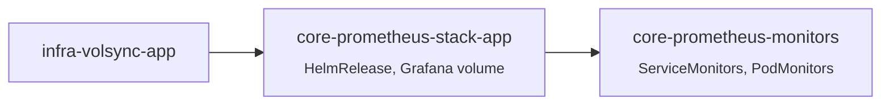

# Prometheus

Metrics, dashboards and alerting with [kube-prometheus-stack](https://github.com/prometheus-community/helm-charts/tree/main/charts/kube-prometheus-stack): Prometheus, Alertmanager, Grafana, kube-state-metrics, node-exporter and the default Kubernetes rules and dashboards.

| | |
| --- | --- |
| **Namespace** | `prometheus` |
| **Chart** | `kube-prometheus-stack` |
| **URLs** | `grafana.`, `prometheus.`, `alertmanager.${CLUSTER_DOMAIN}` |
| **Grafana login** | authentik OAuth (`admins` → Admin, `power` → Editor, others Viewer) |
| **Grafana data** | `grafana-data`, backed up with the [`volsync` component](../../components/README.md#volsync) |

## Structure



| Folder | Flux Kustomization | Content |
| --- | --- | --- |
| `app/` | `core-prometheus-stack-app` | HelmRelease, Grafana OAuth secret, `volsync/` (Grafana volume, own namespace scope) |
| `monitors/` | `core-prometheus-monitors` | Monitors for `infra` and `core` components |

### `monitors/`

Components in `infra` (and `core` components that may start before Prometheus) must not depend on the Prometheus CRDs. They only expose metrics endpoints; the `ServiceMonitor`/`PodMonitor` objects live here, one file per component (`infra-*.yaml`, `core-*.yaml`), all in the `prometheus` namespace with a `namespaceSelector`.

| File | Targets |
| --- | --- |
| `infra-cilium.yaml` | agent, operator, Envoy, Hubble |
| `infra-longhorn.yaml` | manager (allowed by a NetworkPolicy in `infra/longhorn`) |
| `infra-cert-manager.yaml` | controller, cainjector, webhook |
| `infra-flux.yaml` | source, kustomize, helm, notification controllers |
| `infra-volsync.yaml` | controller, through kube-rbac-proxy with the Prometheus token |
| `infra-snapshot-controller.yaml` | snapshot controller |
| `core-cnpg.yaml` | operator and every Postgres instance in any namespace |
| `core-external-secrets.yaml` | controller, webhook, cert controller |
| `core-external-dns.yaml` · `core-traefik.yaml` · `core-loki.yaml` · `core-authentik.yaml` | |

Apps come after `core`, so they can ship their own monitors next to their manifests.

## Configuration highlights

- Prometheus selects monitors and rules from **all namespaces** (`*SelectorNilUsesHelmValues: false`), not only objects labelled `release: kube-prometheus-stack`.
- Scrape/evaluation interval 30 s; 25 Gi volume; memory 1.5 Gi request / 3 Gi limit.
- Control plane scraping on Talos: `kubeProxy` disabled (Cilium replaces it); `kube-controller-manager` and `kube-scheduler` bind on `0.0.0.0`, and etcd exposes metrics on `:2381`, both configured in [talconfig.yaml](../../../talos/talconfig.yaml). etcd runs as a host service, so `kubeEtcd.endpoints` lists the control plane IPs.

> [!NOTE]
> Alertmanager has no receivers yet (`null`): alerts are visible in its UI and in Grafana but are not sent anywhere.

## Maintenance

```sh
# targets that are not up
kubectl get --raw '/api/v1/namespaces/prometheus/services/http:kube-prometheus-stack-prometheus:9090/proxy/api/v1/targets?state=active' \
  | jq -r '.data.activeTargets[] | select(.health!="up") | "\(.scrapePool) \(.lastError)"'
```
