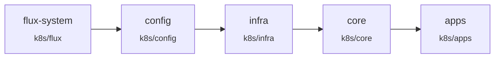

# Flux

Entry point of the GitOps setup. Created by `flux bootstrap`, then extended with the four layer Kustomizations.

| File | Content |
| --- | --- |
| `gotk-components.yaml` | Flux controllers (generated, updated by `flux bootstrap` / Renovate) |
| `gotk-sync.yaml` | `GitRepository/flux-system` (this repo, `main`), `Kustomization/flux-system` (this folder) and the four layers |



Each layer Kustomization has `wait: true` and depends on the previous one. A layer folder only contains namespaces and the per-component `ks.yaml` files; those child Kustomizations do the actual work and declare finer-grained `dependsOn` between components, across layers when needed (e.g. apps depending on `infra-volsync-app`).

Kustomizations that apply `*.sops.yaml` files decrypt them with the `sops-age` secret, created at bootstrap: `config`, `infra-cert-manager-letsencrypt`, `core-external-secrets-bitwarden`. Everything else gets secrets from [External Secrets](../core/external-secrets/README.md). Variables from `cluster-config` and `cluster-secrets` are injected with `postBuild.substituteFrom` by the components that need them.

## Useful commands

```sh
flux get ks -A                       # status of every Kustomization
flux get hr -A                       # Helm releases
flux reconcile ks <name> --with-source
flux suspend ks <name> / flux resume ks <name>
flux build ks <name> --path <dir> --kustomization-file <ks.yaml> --dry-run   # render locally
```
