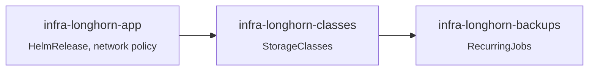

# Longhorn

Replicated block storage on the node disks. Provides every `ReadWriteOnce` volume of the cluster, in-cluster snapshots and backups to the NAS.

| | |
| --- | --- |
| **Namespace** | `longhorn-system` |
| **Chart** | `longhorn` |
| **Backup target** | `nfs://nas-01.aethernode.it:/volume1/polaris-backups` |
| **UI** | `https://longhorn.${CLUSTER_DOMAIN}` (authentik forward-auth, see [traefik/ingresses](../../core/traefik/README.md)) |
| **Metrics** | manager, see [prometheus/monitors](../../core/prometheus/README.md) |

## Structure



`app/` also contains a NetworkPolicy that lets Prometheus reach the manager metrics: the chart policies only admit Longhorn's own components.

## Storage classes

| Class | Replicas | Reclaim | Recurring jobs | Used for |
| --- | --- | --- | --- | --- |
| `longhorn-default` *(default)* | 2 | Retain | `default` group | App config volumes |
| `longhorn-critical` | 3 | Retain | `critical` group | Irreplaceable data (paperless, karakeep) |
| `longhorn-database` | 3 | Retain | none | Postgres (backed up by Barman) |
| `longhorn-volsync` | 1 | Delete | none | VolSync temporary volumes |
| `longhorn-ephemeral` | 1 | Delete | none | Caches; `strict-local`, bound on first consumer |
| `longhorn` | 3 | Delete | none | Chart default, only kept for volumes created before the custom classes |

## Recurring jobs

| Group | Snapshot | Backup to NAS |
| --- | --- | --- |
| `default` | every 6 h, keep 5 | Sunday 02:00, keep 4 |
| `critical` | every 2 h, keep 12 | daily 03:00, keep 7 |

Classes select a group through `parameters.recurringJobSelector`. Longhorn automatically adds the `default` group to any volume without recurring-job labels, so classes that must have **no** jobs select an empty group called `none`.

Volumes holding regenerable data (Prometheus, Loki, Alertmanager, caches, queues) and Postgres volumes are labelled `none` by hand: they are not worth a NAS copy.

```sh
kubectl -n longhorn-system label volumes.longhorn.io <volume> \
  recurring-job-group.longhorn.io/none=enabled recurring-job-group.longhorn.io/default-
```

## Settings worth knowing

- `nodeDrainPolicy: allow-if-replica-is-stopped`: a node holding the only replica of a **detached** volume (restic caches, VolSync volumes) can still be drained — the replica stays on disk across a reboot. Attached volumes remain protected. With the default policy, Talos upgrades hang on draining.

## Maintenance

```sh
kubectl -n longhorn-system get volumes.longhorn.io \
  -o custom-columns=NAME:.metadata.name,STATE:.status.state,ROBUSTNESS:.status.robustness,PVC:.status.kubernetesStatus.pvcName
```

- `degraded` after a node reboot is normal while replicas rebuild.
- **Control plane disks are shared with etcd.** Large rebuilds (Prometheus, Loki) can saturate a control plane disk and make etcd unhealthy: Talos then stops the control plane components on that node until the rebuild ends.
- Orphaned volumes: PVs in `Released` state keep their Longhorn volume (`Retain`). Delete both once the data is no longer needed.
